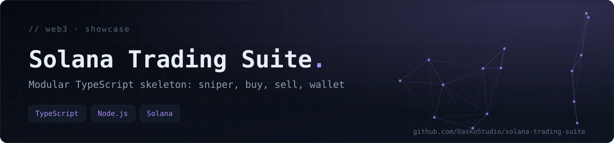
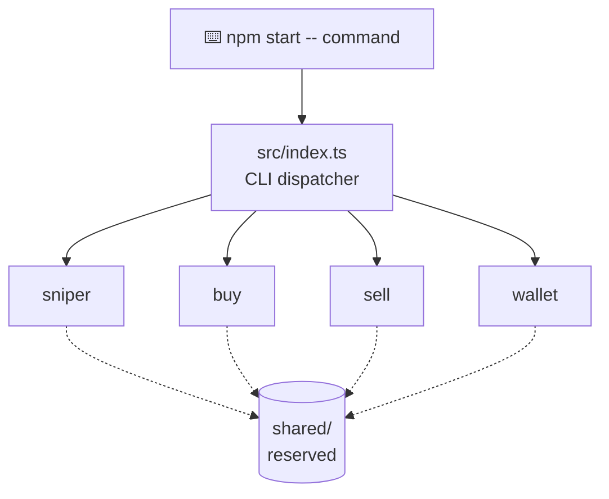

<div align="center">



**A modular TypeScript skeleton showing the architecture of a Solana automation suite: token detection, order execution and wallet management as separate modules behind one CLI dispatcher.**

   

[Concept](#-concept) · [Architecture](#-architecture) · [Getting started](#-getting-started) · [Tech stack](#-tech-stack)

</div>

> [!IMPORTANT]
> **Showcase repository.** The architecture is public; the logic is not. There is **no** RPC call, transaction, strategy, wallet, key generation or key material in this repository. Every module throws `Not implemented (logique privée non incluse)`.

## 📖 Concept

The private suite is split by responsibility so each part can be developed, tested and secured on its own: detecting new tokens, buying, selling and managing wallets. This public version keeps that decomposition and the dispatcher, and replaces the internals with stubs.

## 🏗️ Architecture



## 📦 What this repository contains

| Module | Command | Behaviour here |
|---|---|---|
| `sniper/` | `npm start -- sniper` | Stub — throws, exit code 1 |
| `buy/` | `npm start -- buy` | Stub — throws, exit code 1 |
| `sell/` | `npm start -- sell` | Stub — throws, exit code 1 |
| `wallet/` | `npm start -- wallet` | Stub — throws, no wallet data |
| `src/index.ts` | — | Dispatcher: unknown or missing command → exit code 2 |

`@solana/web3.js` is declared as a dependency but is **not used** by the stubs.

## 🚀 Getting started

**Prerequisites:** Node.js 22+ and npm. No secret or external service is required.

```bash
npm install
npm run typecheck
npm run build
npm start -- sniper
```

Replace `sniper` with `buy`, `sell` or `wallet`. The expected result is the stub error message and exit code `1`; a missing or unknown command returns `2`.

## 🗂️ Project structure

```text
src/index.ts       CLI dispatcher
sniper/index.ts    Stub
buy/index.ts       Stub
sell/index.ts      Stub
wallet/index.ts    Stub (no wallet data)
shared/            Reserved placeholder
tsconfig.json      Strict TypeScript configuration
```

## 🧰 Tech stack

TypeScript · Node.js · `@solana/web3.js` (declared, unused by the stubs)

---

<div align="center">

<sub>Built by <a href="https://github.com/DaskoStudio"><b>Konaté Adama</b></a> · <a href="https://github.com/DaskoStudio?tab=repositories">More projects</a></sub>

</div>
